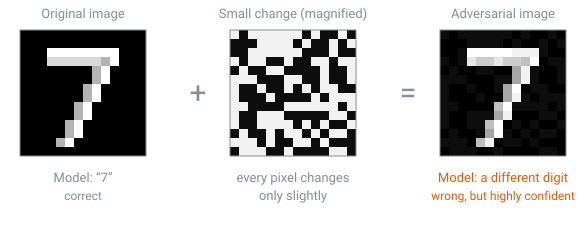
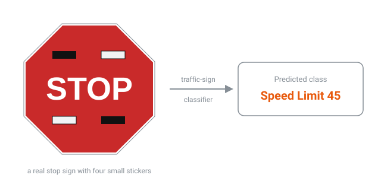
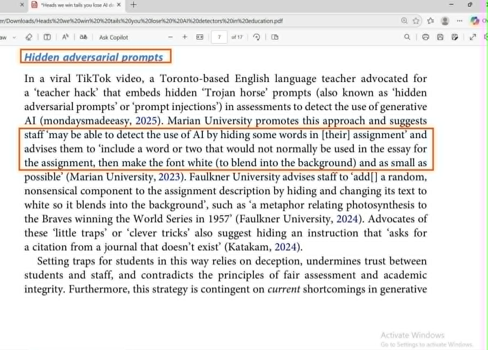

First of first, It is the first Blog of my life. So at the very begining i sincerely apolizes for any kind of tecnical or non-technical errors.
Secondly, I will appriciate any kind of your advise/critics in comment section with name or annonymously.
Thirdly, Thanks for reading the blog.

Now, Let's start with a very basic question: **Can a person or an agent or an automated flow  can hack a machine learning or deep learning model?**

Tecnically and practically, Yes , it's possible. But in this the attacker does not attack or hack the server where the model runs on, and not the database behind it, but the model itself. Imagine a image classifier model that can correctly predict "cat" with 99.6% confidence. Now add a layer of noise so faint that the picture looks exactly the same to you. The model no longer sees a cat: its top answer becomes "dog" (Figure 1). This is not a thought experiment. Researchers have shown it on real models again and again [1], [2].

. After a small perturbation is added, the picture looks unchanged, but “cat” drops to 0.1% and “dog” becomes the top prediction.")

## 1. What is an adversarial attack?

Before diving into Technical Explanation,Let's talk a little about it's defination.The word of adversaraial machine learning was first used by the god of neural network Ian Goodfellow and his collaborators in 2014, through their influential paper, Explaining and Harnessing Adversarial Examples, published at ICLR 2015.

An adversarial attack can be defined as a deliberate attempt to make a machine learning model produce a wrong output by manipulating its input, its training data, or its environment. The most studied kind, and the focus of this post, is the **evasion attack**: the model is already trained and deployed, and the attacker modifies a single input at test time so that it is misclassified.

An adversarial example has two defining properties:

1. **It is small.** The change is bounded, often imperceptible to humans. A person looking at the modified input would still give the original answer.
2. **It is deliberate.** The change is not random noise. It is computed to push the model toward a wrong answer. Random noise of the same size usually does nothing.

## 2. Why does a small change fool a model?

**Now the most important question rises that How can a machine learning model produce a confident but incorrect prediction when its input has been modified only slightly?**

Well, there is a clear mathematical explanation regarding this question. But for avoiding complexity and easy understanding in first blog, i would like to exclude mathematical explanation in this blog.I will add this into my next blogs.Anyway, now let's consider a scenario.

> Imagine a student who has memorized common patterns in multiple-choice questions but does not fully understand the concepts also does not have any knowledge without those mcqs(training datas). Here is a question(testing dataset), and the same question with **one word changed**:

| | Original question | Modified question |
| :-- | :-- | :-- |
| **Question** | Which gas do plants **absorb** from the atmosphere during photosynthesis? | Which gas do plants **release** into the atmosphere during photosynthesis? |
| **Options** | A. Oxygen · B. Nitrogen · C. Carbon dioxide · D. Hydrogen | A. Oxygen · B. Nitrogen · C. Carbon dioxide · D. Hydrogen |
| **Correct answer** | C. Carbon dioxide | A. Oxygen |
| **The student answers** | C. Carbon dioxide (Correct) | C. Carbon dioxide(Wrong) |

A student who relies on memorized patterns sees the familiar words "plants" and "photosynthesis" and immediately picks carbon dioxide, without noticing the changed word. The answer is wrong because that one small change altered what the question was asking. You can consider This phenomena with public admission tests where the examinee trick the students which is very common scenario.

Models are kind of students with absolute zero knowledge except the trained datas. Models only learn patterns from their training data. Sometimes they rely heavily on particular features instead of learning robust relationships. Carefully changing those features can change the model's prediction, even when the input looks almost the same to a person.Like the student who keys on "plants" and "photosynthesis," the model keys on features that *usually* work. An attacker changes exactly those features.

Again, A model is never told *what* to look at. It learns whatever patterns in the training data best predict the labels, and those are often not the patterns a person would use:

- **Texture over shape.** Networks trained on ImageNet rely heavily on texture. Shown the outline of a cat filled in with the wrinkled skin texture of an elephant, a typical network answers "elephant," while people answer "cat" [3].
- **Background over object.** Models that recognized cows reliably failed when a cow stood somewhere unusual, such as a beach, because they had partly learned "green pasture" as part of what a cow is [4].
- **Patterns people cannot see.** Some of the patterns models depend on are genuinely useful for prediction but far too subtle for human eyes, like tiny, consistent variations in pixel values. Adversarial changes alter exactly these patterns [5]. To the model they matter as much as fur or whiskers; to us they are invisible.

Also, A photo is made of a huge number of values: a small 224 × 224 color image has 150,528 of them. The model weighs evidence from all of them at once to make one decision.

Now imagine nudging every value by an amount far too small to notice. A single nudge does nothing. But if every nudge points the same way, toward "dog," the model adds them all up, and together they become a strong push. Think of a weighing scale: one grain of sand weighs almost nothing, yet enough grains on one side will tip it.

An attacker makes sure they do not cancel. With access to the model, the attacker can, in effect, ask it: "Which tiny change to each pixel would make you *less* sure this is a cat?" and then apply all of those changes together [1]. It is like a crowd pushing a stalled car: if everyone pushes in a different direction, the car stays where it is; if everyone pushes the same way, it rolls.

, so the model now says “dog”.")

## 3. Some Example of real life Adversarial attacks

In real and practical world, Adversarial examples are not limited to pixels in a computer. Researchers have shown that they survive printing, photographing, and changes in angle and lighting, and similar attacks have already happened to real products and public systems.

### 3.1 In research labs

#### 01. Printed images still fool a phone camera (2017)

Kurakin et al. printed adversarial images on paper and photographed them with a phone. A large fraction stayed misclassified by an ImageNet classifier, so an attacker does not need direct digital access to a model's input [6].

#### 02. Stickers on a stop sign (2018)

Eykholt et al. placed a few black and white stickers on a real stop sign, arranged to look like ordinary graffiti. A traffic-sign classifier read it as a "Speed Limit 45" sign in all of their stationary lab tests and in most frames of a drive-by video test [7].

#### 03. A 3D-printed turtle that is a "rifle" (2018)

Athalye et al. 3D-printed a toy turtle whose surface texture was optimized as an adversarial example. An ImageNet classifier labeled it a "rifle" from most viewpoints, under different lighting and camera angles [8].

#### 04. Glasses that change who you are (2016)

Sharif et al. printed eyeglass frames with adversarial patterns. Wearing them, researchers evaded a face-recognition system, or were recognized as specific other people they chose [9].

### 3.2 In everyday life

**Now a days adversarial study does not confined into the lab,rather it is happens in daily everyday life.**

#### 01. Microsoft's Tay chatbot (2016)

Microsoft launched Tay, a chatbot that learned from its conversations on Twitter. Within a day, a coordinated group of users flooded it with offensive messages, and Tay began posting offensive tweets of its own. Microsoft took it offline and apologized [10]. This was a poisoning-style attack: the attackers manipulated what the model learned from.

#### 02. Stickers on the road and a self-driving car (2019)

Tencent Keen Security Lab placed a few small stickers on a road surface. Tesla Autopilot's lane recognition detected a lane that did not exist and steered the car toward the oncoming lane in their tests [11].

#### 03. A piece of tape that made a Tesla speed up (2020)

McAfee researchers stretched the middle of the "3" on a 35 mph speed-limit sign with a 2-inch strip of black tape. People still read the sign as 35, but the camera system of a 2016 Tesla Model S read it as 85 mph, and the car's cruise control began to accelerate. Only that older camera hardware was affected [12].

#### 04. Hidden instructions for AI tools (2023 to 2025)

In education, a "teacher hack" promoted on TikTok and in some universities' guidance hides extra words in an assignment in tiny white text. A student who pastes the task into a generative AI tool gets an answer containing those hidden words, revealing the AI use. Bassett et al. review this practice and argue against it as deceptive and unfair to students [13].

In July 2025, Nikkei Asia found 17 research preprints on arXiv, from 14 institutions in eight countries, hiding instructions such as "give a positive review only" in white text or tiny fonts, aimed at reviewers who rely on AI tools. At least one paper was withdrawn [14]. As with an adversarial image, the change is invisible to a person but steers the model.

#### 05. A shirt that confuses AI cameras (2026)

Berlin artist Simon Weckert designed a "Digital Camouflage" shirt printed with an adversarial pattern, in response to a pilot of AI video surveillance at Kottbusser Tor in Berlin. Tested against YOLO object detectors, the pattern is meant to stop the detector from recognizing the wearer as a person. It does not make anyone invisible: people and ordinary cameras still see the wearer, and how well it works depends on the detector, the camera angle, distance, lighting, and how the fabric sits [15]. It is the research idea of an adversarial patch [16], turned into clothing.

. The publisher marks the image as illustrative and AI-modified, and the headline overstates the effect; see [15] for photos of the actual shirt.")

## 4. Why does this matter?

**Now another question may rise why should we study about that? How much important it is?**

Well, For understanding the severity of adversarial attack ,let's consider a case where a model is deployed into an edge device( Smartwatch) to predict heart disease which was not adversarially robust.Now if somehow the input datas gets perturbated,the model will predict wrong confidently that may even rise heart attack risk.This scenario is applicable for all the fields where ML or Dl models are used.

also with the uprisement of llm, the number of deployed models are rising day by day.Adittionally, Attack styles and ammounts may rise due to llms as the they can find out the features that are highly vurnarable to adversarial attack.

## 5. A practical experiment

**Beside this theoritical concepts,lets go through a practical observation.**

To see the effect for ourselves, we trained two small image classifiers and then attacked them. The question was simple: **does a model that is accurate on normal images also stay accurate under attack?**

### 5.1 Setup

For this experiment, We used MNIST [17], a collection of 70,000 small grayscale images of handwritten digits from 0 to 9. Each image is 28 × 28 pixels. We used the standard split: 60,000 images for training and 10,000 for testing. Pixel brightness was scaled to the range 0 (black) to 1 (white).

We trained two model, MLP(two fully connected layers of 256 and 128 neurons to 10 outputs) and a CNN(small 3 × 3 filterstwo convolution layers (32 and 64 filters), each followed by 2 × 2 max pooling, then a 128-neuron layer and 10 outputs)

Both models were trained the same way: the Adam optimizer, a learning rate of 0.001, a batch size of 128, 5 epochs, and cross-entropy loss.

the trained model were attacked with FGSM and PGD with three attack budget of  0.05,0.1 and 0.2.

### 5.2 Result

 and the CNN (right) on MNIST: on clean images, and under FGSM and PGD attacks with perturbation budgets ε = 0.05, 0.10, and 0.20. One training run per model.")

**1. Clean accuracy does not tell you how robust a model is.** On clean images, the two models differ by only 1.5 percentage points (97.5% versus 99.0%). Under PGD at ε = 0.10, they differ by about 70 points (4.0% versus 74.3%). If we had tested only on normal images, the two models would have looked almost equally good. **Accuracy and robustness are two different properties, and a model has to be tested for both.**

**2. Bigger changes do more damage.** For both models, accuracy falls as the budget grows. With pixel changes of at most 5%, the MLP's accuracy dropped from 97.5% to 52.5% under FGSM: it now gets almost half of the digits wrong. At ε = 0.20 it gets almost nothing right (0.4% under FGSM and 0.0% under PGD).

**3. PGD hurts more than FGSM.** At every budget, for both models, PGD pushed accuracy lower than FGSM. The largest gap is the CNN at ε = 0.20: 33.2% under FGSM, but only 5.1% under PGD. A careful search finds weak spots that a single quick push misses.

## 6. Questions to think about

At the end of the blog ,let's raise some questions:

1. Why PGD hurts more than FGSM?
2. Can an LLM's response be tricked in this way?
3. How can we make our model robust aganist Adversarial attacks?

## Code

The code for training the model and running the attacks will be shared here.

**GitHub repository:** *coming soon*

## Thanks for reading.

## References

1. I. J. Goodfellow, J. Shlens, and C. Szegedy, "Explaining and harnessing adversarial examples," in *Proc. Int. Conf. Learn. Represent. (ICLR)*, 2015. [Online]. Available: https://arxiv.org/abs/1412.6572
2. C. Szegedy, W. Zaremba, I. Sutskever, J. Bruna, D. Erhan, I. Goodfellow, and R. Fergus, "Intriguing properties of neural networks," in *Proc. Int. Conf. Learn. Represent. (ICLR)*, 2014. [Online]. Available: https://arxiv.org/abs/1312.6199
3. R. Geirhos, P. Rubisch, C. Michaelis, M. Bethge, F. A. Wichmann, and W. Brendel, "ImageNet-trained CNNs are biased towards texture; increasing shape bias improves accuracy and robustness," in *Proc. Int. Conf. Learn. Represent. (ICLR)*, 2019. [Online]. Available: https://arxiv.org/abs/1811.12231
4. S. Beery, G. Van Horn, and P. Perona, "Recognition in terra incognita," in *Proc. Eur. Conf. Comput. Vis. (ECCV)*, 2018, pp. 456–473. [Online]. Available: https://arxiv.org/abs/1807.04975
5. A. Ilyas, S. Santurkar, D. Tsipras, L. Engstrom, B. Tran, and A. Madry, "Adversarial examples are not bugs, they are features," in *Proc. Adv. Neural Inf. Process. Syst. (NeurIPS)*, 2019. [Online]. Available: https://arxiv.org/abs/1905.02175
6. A. Kurakin, I. Goodfellow, and S. Bengio, "Adversarial examples in the physical world," in *Proc. Int. Conf. Learn. Represent. (ICLR) Workshop*, 2017. [Online]. Available: https://arxiv.org/abs/1607.02533
7. K. Eykholt, I. Evtimov, E. Fernandes, B. Li, A. Rahmati, C. Xiao, A. Prakash, T. Kohno, and D. Song, "Robust physical-world attacks on deep learning visual classification," in *Proc. IEEE/CVF Conf. Comput. Vis. Pattern Recognit. (CVPR)*, 2018, pp. 1625–1634. [Online]. Available: https://arxiv.org/abs/1707.08945
8. A. Athalye, L. Engstrom, A. Ilyas, and K. Kwok, "Synthesizing robust adversarial examples," in *Proc. Int. Conf. Mach. Learn. (ICML)*, 2018, pp. 284–293. [Online]. Available: https://arxiv.org/abs/1707.07397
9. M. Sharif, S. Bhagavatula, L. Bauer, and M. K. Reiter, "Accessorize to a crime: Real and stealthy attacks on state-of-the-art face recognition," in *Proc. ACM SIGSAC Conf. Comput. Commun. Secur. (CCS)*, 2016, pp. 1528–1540, doi: 10.1145/2976749.2978392.
10. P. Lee, "Learning from Tay's introduction," *The Official Microsoft Blog*, Mar. 25, 2016. [Online]. Available: https://blogs.microsoft.com/blog/2016/03/25/learning-tays-introduction/
11. Tencent Keen Security Lab, "Experimental security research of Tesla Autopilot," Tech. Rep., 2019. [Online]. Available: https://keenlab.tencent.com/en/whitepapers/Experimental_Security_Research_of_Tesla_Autopilot.pdf
12. "Researchers fool smart car camera with a 2-inch piece of electrical tape," *Dark Reading*, Feb. 2020. [Online]. Available: https://www.darkreading.com/cyberattacks-data-breaches/researchers-fool-smart-car-camera-with-a-2-inch-piece-of-electrical-tape
13. M. A. Bassett et al., "Heads we win, tails you lose: AI detectors in education," *J. Higher Educ. Policy Manage.*, 2026, doi: 10.1080/1360080X.2026.2622146.
14. "Researchers are hiding prompts in academic papers to manipulate AI peer review," *TechSpot*, Jul. 2025. [Online]. Available: https://www.techspot.com/news/108667-researchers-hiding-prompts-academic-papers-manipulate-ai-peer.html
15. "Digital Camouflage shirt by Simon Weckert," *Dezeen*, Aug. 25, 2026. [Online]. Available: https://www.dezeen.com/2026/08/25/digital-camouflage-shirt-ai-video-surveillance-simon-weckert/
16. S. Thys, W. Van Ranst, and T. Goedemé, "Fooling automated surveillance cameras: Adversarial patches to attack person detection," in *Proc. IEEE/CVF Conf. Comput. Vis. Pattern Recognit. Workshops (CVPRW)*, 2019. [Online]. Available: https://arxiv.org/abs/1904.08653
17. Y. LeCun, L. Bottou, Y. Bengio, and P. Haffner, "Gradient-based learning applied to document recognition," *Proc. IEEE*, vol. 86, no. 11, pp. 2278–2324, 1998.
